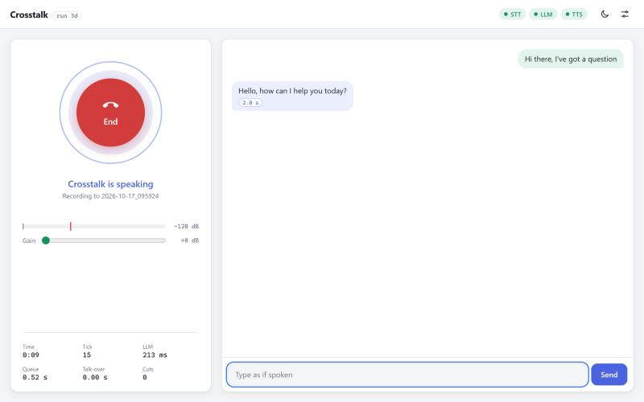

# Crosstalk

A phone agent that listens while it talks.

Crosstalk is a full-duplex voice agent: every 0.6 s the model gets what the caller said in that moment and replies with up to three words, or `<listen>` to say nothing. That lets it answer the moment a caller stops, say "mhm" while they talk, and stop when they cut in. This repo is the client: the micro-turn loop, a browser UI, and the scripts that serve the model and the speech recogniser.

Model weights: [EryriLabs/Crosstalk-35B-A3B-GGUF](https://huggingface.co/EryriLabs/Crosstalk-35B-A3B-GGUF). It builds on [codacus/Qwen3.6-35B-A3B-MicroTurn-Duplex-LoRA](https://huggingface.co/codacus/Qwen3.6-35B-A3B-MicroTurn-Duplex-LoRA) and the micro-turn idea from DuplexCascade ([arXiv 2603.09180](https://arxiv.org/abs/2603.09180)).



## Requirements

- One RTX 3090 class GPU with 24 GB for the LLM
- A second small GPU, or the CPU, for the TTS
- Windows or Linux, Python 3.10 or newer
- [llama.cpp](https://github.com/ggml-org/llama.cpp), tested with b11580
- [NeMo-Speech.cpp](https://github.com/NVIDIA/NeMo-Speech.cpp) with Nemotron 3.5 ASR Streaming 0.6B (`nemotron-3.5-asr-streaming-0.6b.q8_0.gguf` from `nvidia/nemotron-3.5-asr-streaming-0.6b`)

## Install

```
python -m venv .venv
.venv/Scripts/python -m pip install -r requirements.txt
```

On Windows, PyPI's torch is CPU only. For the TTS on a GPU, add:

```
.venv/Scripts/python -m pip install --force-reinstall --no-deps torch==2.14.1+cu130 --index-url https://download.pytorch.org/whl/cu130
```

On Linux use `.venv/bin/python`. Pocket TTS downloads its weights from Hugging Face on first start.

## Run

Three processes, from Git Bash or a Linux shell:

```
CUDA_VISIBLE_DEVICES=0 LLM_MODEL=/path/to/Crosstalk-35B-A3B-UD-Q4_K_M.gguf ./scripts/serve_llm.sh
CUDA_VISIBLE_DEVICES=1 STT_MODEL=/path/to/nemotron-3.5-asr-streaming-0.6b.q8_0.gguf ./scripts/serve_stt.sh
PYTHON=.venv/Scripts/python ./scripts/run_ui.sh --tts-device 1
```

Open http://127.0.0.1:7860 in a current Firefox, Chrome or Edge and wear headphones. Firefox cannot pick the output device, so set your headset as the system default there. In Settings, pick the microphone and output and click Test mic, then press the call button. Echo cancel is off by default because it also suppresses your voice while the agent talks, which breaks barge-in.

Each call is saved under `ui/calls/<time>/`: `call.wav` (left caller, right agent), `events.jsonl` and `summary.json`.

## Flags that matter

- `serve_llm.sh`: 32k context, 4 slots (`SLOTS`). If the model does not fit on one card, `N_CPU_MOE=12` keeps the experts of the first 12 layers on the CPU (about 16.5 GB on the GPU, about 70 ms more per tick). `LLAMA_SERVER` and `PORT` set the binary and port.
- `serve_stt.sh`: 160 ms steps (`RIGHT_CONTEXT=1`) with endpointing on. The client asks for 500 ms of silence per session (`--endpoint-ms`). `NEMO_SPEECH` sets the binary. It needs about 1.2 GB and fits next to the LLM.
- `run_ui.sh` passes its arguments to `ui/server.py`:
  - `--tts grow` (default) feeds each reply into one Pocket TTS stream as the words arrive. Use it on a GPU. On the CPU, `--tts pytorch` starts sooner.
  - `--tts-device` is `cpu` (default) or a CUDA index or UUID.
  - `--voice anna`, `--persona ui/persona.txt` (`--persona ''` for none; the model was trained without one and talks over the caller a little more with it), `--no-echo-filter`, `--host 0.0.0.0`.
- The page's Settings has the turn-taking rules, on by default: answer after final, backchannel gate, re-ask mid-answer only, and the listen threshold (0.3).

## Testing without a microphone

`scenarios/` has four scripted callers made with speech synthesis, each with its word times in a `.json`:

```
cd ui
../.venv/Scripts/python -I check.py --text "hello, have you got a minute"
../.venv/Scripts/python -I check.py --wav ../scenarios/pause.wav
```

`loop.py` runs the same loop without the UI and measures time to first word, talk-over and barge-in against the script:

```
.venv/Scripts/python -I loop.py --wav scenarios/barge.wav --out results/barge --tts-device 1
```

## Voice

The demo voice is Pocket TTS's built-in voice "anna", VCTK speaker p228. Its voice embedding comes from [kyutai/tts-voices](https://huggingface.co/kyutai/tts-voices) (vctk folder, CC BY 4.0). Pocket TTS code is MIT and its weights are CC BY 4.0. The Pocket TTS model card forbids cloning a voice without the speaker's consent.

## Licence

Apache 2.0
